# pickje

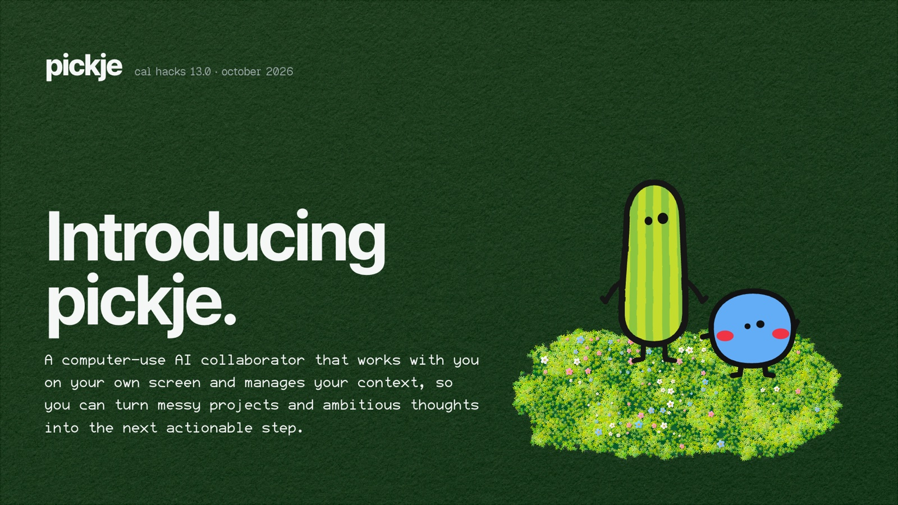

**pickje sees what you mean.** A computer-use AI collaborator that works with you on your own screen and manages your
context, so you can turn messy projects and ambitious thoughts into the next actionable step.

Built at Cal Hacks 13.0 (Fri 10-23 to Sun 10-25, 2026) for **college students with ADHD whose ambition doesn't fit in one
app**. This repo holds the pitch deck, the brand and design system, and the source of the public lab notebook. The
product itself (the Mac app, the talk server and every sponsor's code) is in its own repo.

| | |
|---|---|
| **The pitch deck** (22 slides; this README follows it) | this repo: `npm install && npm run dev`, then open `http://127.0.0.1:5320/?deck=pitch`. The script, slide by slide: [deck/pitch/SCRIPT.md](deck/pitch/SCRIPT.md) |
| **The lab notebook, in Mana** (public, opens signed out) | [mana.space/home/…/pickje](https://www.mana.space/home/4AcsNaiqj9gLBK0bQ7kQOAt7BTo2/pickje): the idea log first, then the build's notebook below it |
| **The product** | [github.com/Jshengdev/pickje](https://github.com/Jshengdev/pickje) |
| **One page per sponsor**, with its health check | [pickje/docs/sponsors](https://github.com/Jshengdev/pickje/tree/master/docs/sponsors) · every number in one table: [HEALTH.md](https://github.com/Jshengdev/pickje/blob/master/docs/sponsors/HEALTH.md) |

**On this page:** [The story](#the-story) · [pickje × its sponsors](#pickje--its-sponsors):
[Anthropic](#anthropic) · [Microsoft](#microsoft) · [Cartesia](#cartesia) · [Moss](#moss) · [Convex](#convex) ·
[Elastic](#elastic) · [Factory](#factory) · [Mana](#mana) · [The design system](#the-design-system)

Every number below comes from a committed run or receipt in the product repo, and each sponsor's numbers are copied
from its page there. Where a number has a catch, the catch is written next to it.

---

## The story

### This is Mia

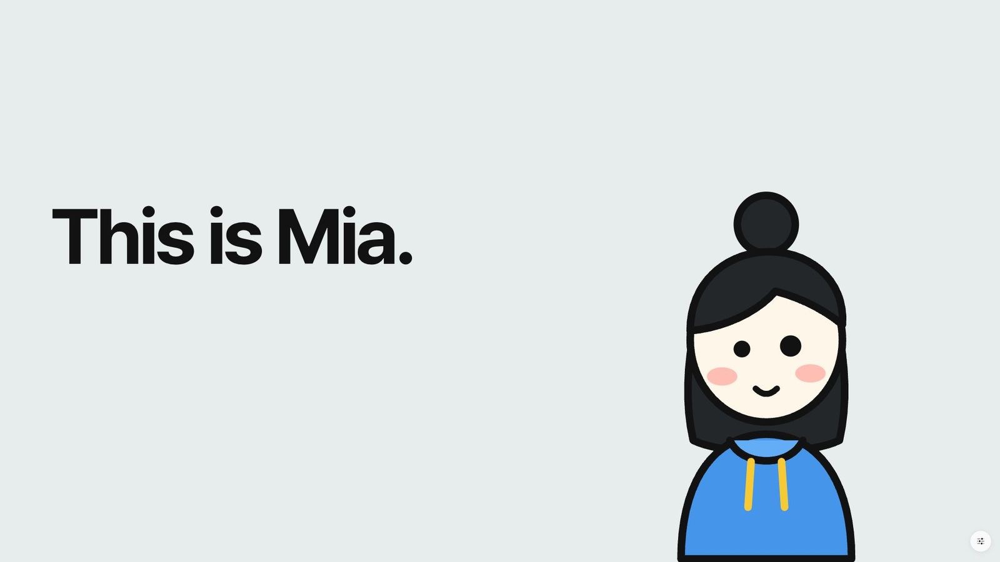

Like anyone else, Mia is ambitious. She's smart. She's designing a car in 3D CAD for her club. She's learning to
invest. And she's teaching herself to edit videos. But one thing keeps stopping her. She has too many interests, too
many projects, too many things she needs to do. So nothing starts.

### It's not just Mia

Mia has ADHD, like **15.5 million** U.S. adults (6.0%, a current diagnosis, self-reported; CDC, MMWR 73(40), Oct 2024).
ADHD makes focus hard to hold, and the way we work now keeps pulling focus apart. People switch apps about **1,200
times a day** and spend **nearly 4 hours a week** finding their place again
([Harvard Business Review, Aug 2022](https://hbr.org/2022/08/how-much-time-and-energy-do-we-waste-toggling-between-applications):
137 people at 3 Fortune 500 companies). After an interruption it takes about **23 minutes** to get back
([Gloria Mark, UC Irvine](https://news.gallup.com/businessjournal/23146/too-many-interruptions-work.aspx): one study,
36 workers). Those studies measured office workers, not students, but they show how big the problem is.

AI is making it bigger. Every new AI tool is its own window: one more place to switch into, one more context to rebuild
from nothing. More tools mean more windows, and more windows mean more switching. For someone who already fights for
focus, every switch costs more. Mia's ambition is there, but the start isn't.

### The obvious fix makes it worse

The obvious solution is to use AI for help. She types out a question. It answers with a wall of text. She screenshots
the question for more clarity, and pastes it back in. While she waits, she starts another session for another project.
Then another. And another. Soon there are ten, each a different project, and none of them knows about the others.

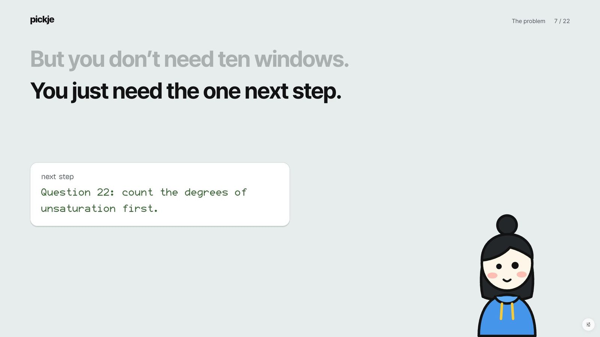

But you don't need ten windows. You just need the one next step.

### There's always a tool for more

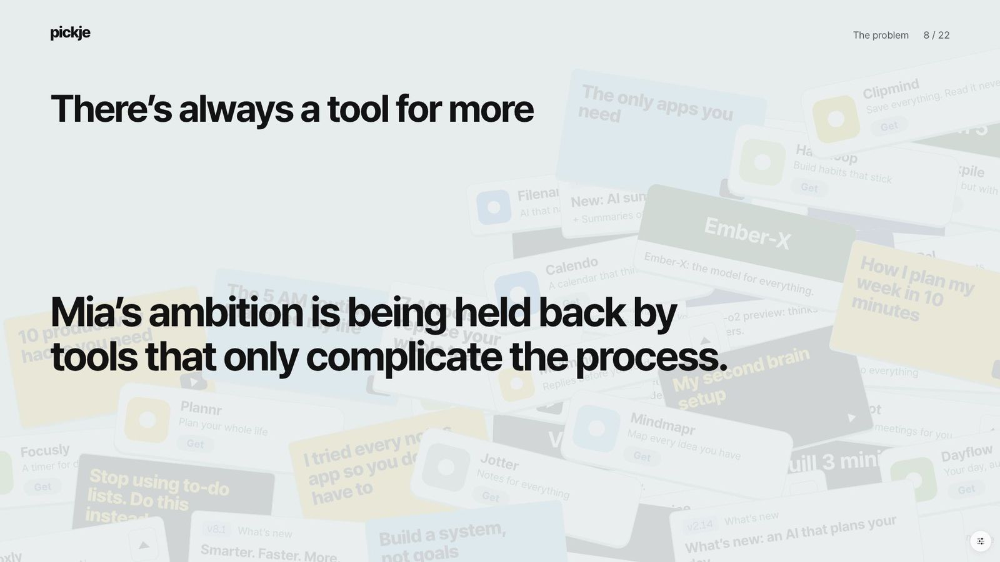

A new model every week. A new AI tool for every niche. A new hack to stay on top of it all. Mia's ambition is being held
back by tools that only complicate the process.

### One that does it with you

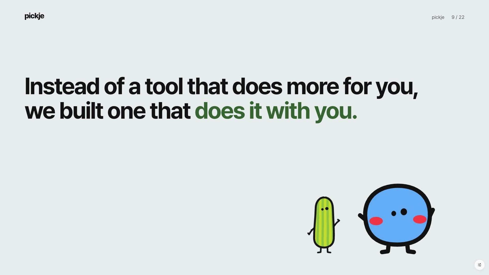

Instead of a tool that does more for you, we built one that does it with you, on the screen where the work already is.
You're stuck on something (a worksheet, a model, a page). Shake the pointer, point or circle, ask out loud, and shake
again to send it. A pause never cuts you off.

### Meet Pickle and Blicky

<p>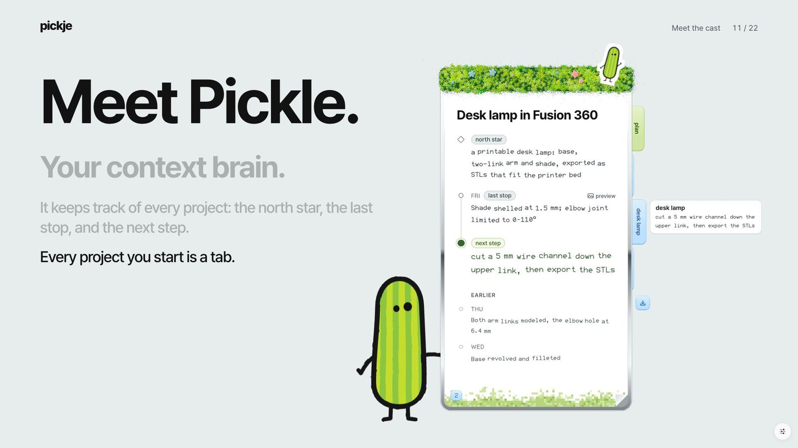 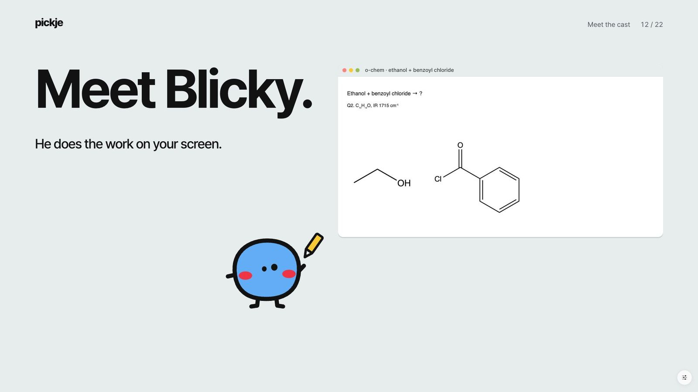</p>

- **Pickle, your context brain.** It keeps track of every project: the north star, the last stop, and the next step.
  Every project you start is a tab on its notepad. It stays quiet, and speaks up only to check where your words should go
  (another project, or a new one) or before it closes something out. (The app labels him Pickje, after the product;
  the code still says `pickle`.)
- **Blicky does the work on your screen.** He flies to the spot and draws it out with you, right on your own document:
  rings, curved arrows, labels, a worked panel, a molecule drawn live from SMILES. He talks you through one step at a
  time, his voice waiting for each mark to land, and he keeps every diagram in his scratchpad, so your thoughts stay
  organized.

### Built to do it with you: five decisions

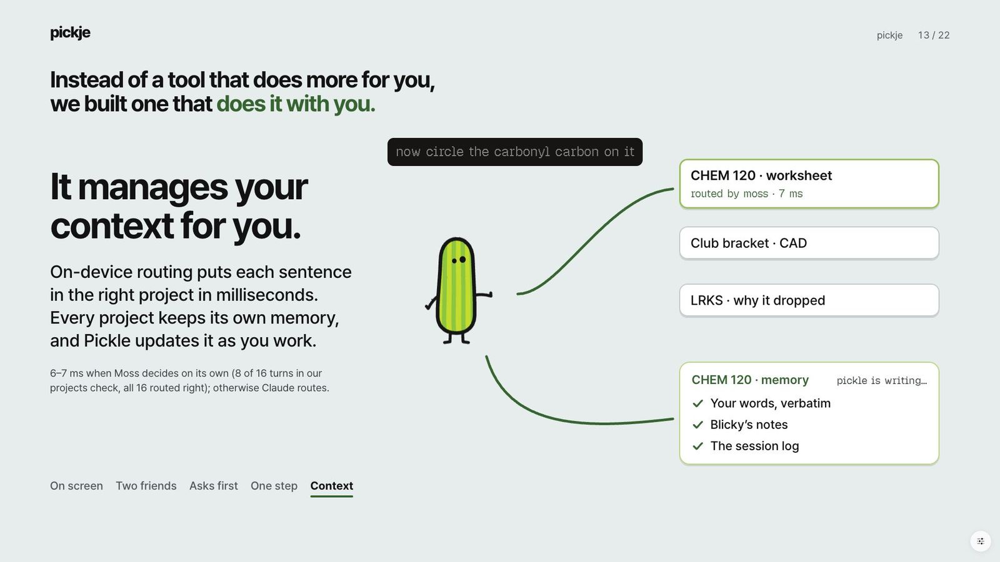

1. **It works where your work is.** Nothing opens in a new chat window: no screenshots, no pasting, no explaining it
   all again. It all happens on your screen, on top of what you're working on.
2. **Two friends, two jobs.** Pickle keeps track of everything for you; Blicky shows you everything, right on your
   screen.
3. **It asks before it acts.** A check-or-no before it switches projects, closes something out, or hands work to Droid,
   so you stay in the driver's seat. No answer in 10 seconds counts as a yes.
4. **One step at a time.** Blicky teaches the next step and holds back a result you haven't reached until you ask for
   it.
5. **It manages your context for you.** On-device routing puts each sentence in the right project in milliseconds (6–7
   ms when Moss decides on its own, which it did on 8 of 16 turns; Claude routes the rest; 16/16 right either way).
   Every project keeps its own memory, and Pickle updates it as you work.

### Where your context lives

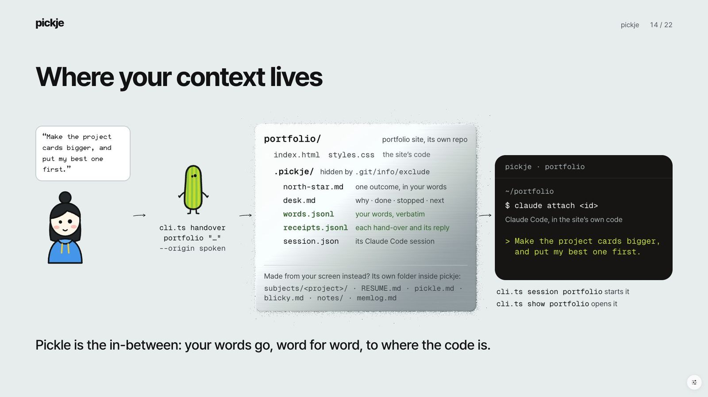

Every project keeps its context in its own folder, as plain files, so your tools can reach it:

- A project Pickle starts from your screen lives at `subjects/<project>/`: `RESUME.md` (north star, last stop, next
  step), `words.jsonl` (your words, verbatim), `notes/`, `references/` and `memlog.md`.
- Each folder carries its own `CLAUDE.md` and `.claude/settings.json` hooks, so **any Claude Code session opened there
  picks up the thread** and logs its start and stop to `memlog.md`. Open one in any project and go as deep as you like.
- A code repo you attach (`node app/service/cli.ts attach <repo>`) gets a `.pickje/` folder, kept out of git by
  `.git/info/exclude`: `north-star.md`, `desk.md`, `words.jsonl`, `receipts.jsonl` and `session.json`.
- **Pickle is the in-between.** `cli.ts session <project>` starts the project's Claude Code session, and
  `cli.ts handover <project> "<words>"` passes your words to it word for word, so design feedback lands exactly where the
  website's code is. (Today that hand-over is a command. A spoken hand-over goes to Factory's Droid, or to Claude Code
  when Droid isn't set up.)

### The demo

- **The onboarding.** Shake your cursor to wake Pickle, and he pops up at it. He tests your mic by asking your name, and
  your words show as heard. Little Blicky pops up and tells you what he can do. Circle anything on your screen and ask out
  loud: it watches what just happened and answers your points one by one, and each circle leaves a numbered pin. Ask
  about something from earlier, and it catches you up on what was on your screen.
- **Four screens, no new chats.** The o-chem worksheet: Blicky teaches it step by step and draws the structures, but
  never gives the answer away. The Cal Student Hub: "Pickle, I'm overwhelmed." Pickle points at what's due first and
  gives her one next step. A stocks page: why did it drop 18% the day after earnings? A design critique: what's wrong
  with this layout? You don't need a new chat for each one. Pickle creates a tab for each, automatically.
- **Nothing in pickje is chemistry-specific.** The drawing marks, the project memory and the voices work on any screen.

### Tonight, Mia started

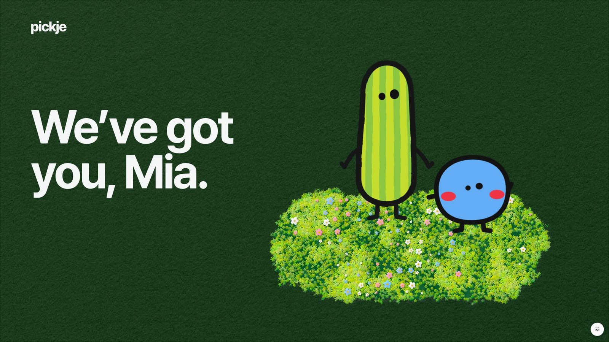

Tonight, Mia started. Not with ten sessions, but with one next step. It remembers everything you're juggling. It gives
you one next step, not a wall. And it already works: in the latest live exam on a real Mac screen, Claude Opus answered
all 36 turns, held back the result in 33 of 34 checks, and got the chemistry right in 47 of 50. The whole rubric is at
62%, under the 80% bar we set ourselves, and we say so ([Microsoft](#microsoft) has the full exam).

We've got you, Mia.

---

## pickje × its sponsors

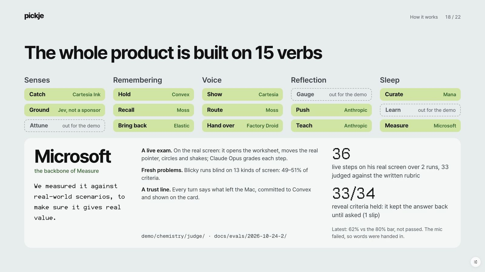

**The whole product is built on 15 verbs**, and each sponsor carries the verbs it's built for. Three are out for the
demo, and one (Ground) runs on Jev, TypeSafe's model, which isn't a sponsor.

| Senses | Remembering | Voice | Reflection | Sleep |
|---|---|---|---|---|
| **Catch**: Cartesia Ink | **Hold**: Convex | **Show**: Cartesia | Gauge: out for the demo | **Curate**: Mana |
| Ground: Jev, not a sponsor | **Recall**: Moss | **Route**: Moss | **Push**: Anthropic | Learn: out for the demo |
| Attune: out for the demo | **Bring back**: Elastic | **Hand over**: Factory Droid | **Teach**: Anthropic | **Measure**: Microsoft |

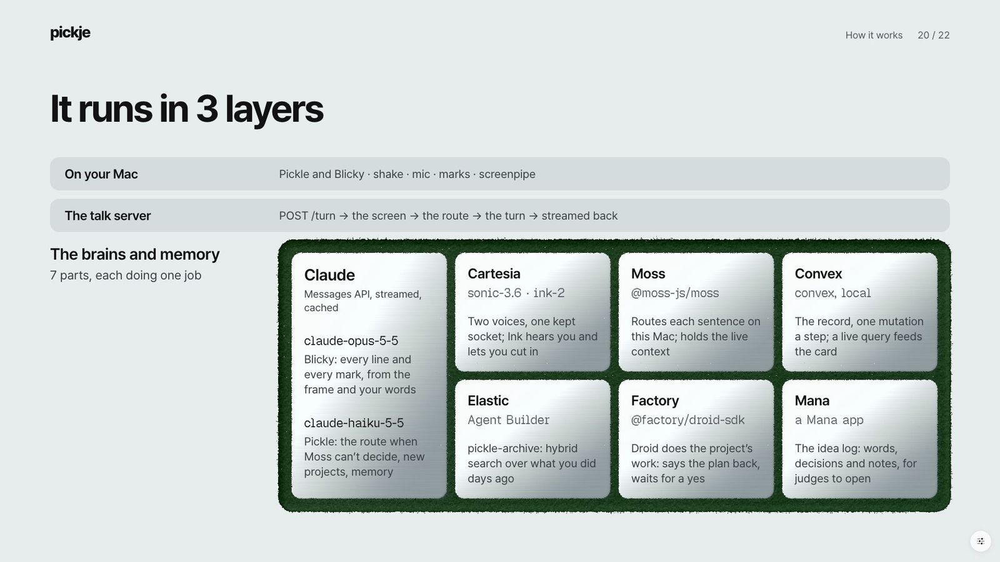

**It runs in 3 layers.** On your Mac: Pickle and Blicky drawn in SwiftUI, shake and circle, the mic and its gate,
Blicky's marks, the voice that waits for its mark, and screenpipe's eyes. The talk server: one turn (the door, which
answers 127.0.0.1 only and wants a bearer token; the screen; the route; the turn; the voice, streamed back). The brains
and memory: seven parts, each doing one job.

**One turn, end to end, with every sponsor in its place:**

```
 Mia shakes the pointer, circles the problem and asks out loud
   │
   ├─ Cartesia Ink 2 hears her and decides when her turn has ended (a pause mid-thought doesn't cut her off)
   ├─ Moss files the sentence to its project on the Mac in 6–7 ms, or Claude Haiku decides from Moss's top 3
   ├─ Elastic brings back the project's library if she's been away 8 h or more (where she stopped, what she decided)
   ├─ Claude Opus reads the screenshot and writes Blicky's lines and marks; Jev puts the exact box on a named part
   ├─ Cartesia Sonic speaks each line as its pen mark lands, in two cloned voices
   ├─ Claude Haiku rewrites the project's memory; Convex commits the step and the card updates live
   └─ when she hands work over, Factory's Droid does it in the project's folder, fenced, after a yes,
      and what it makes is what Blicky shows next

 Around every turn: Microsoft's bar grades the whole product on a real screen, and Mana keeps the idea log and the
 build's lab notebook, public.
```

| Sponsor | Verbs | What it does for Mia | One number |
|---|---|---|---|
| [Anthropic](#anthropic) | Teach, Push | Claude reads her screen, writes every line Blicky says, picks every mark, routes, names projects, rewrites memory, grades the exams; built in and running on Claude Code | 36 / 36 live turns on Claude Opus 5.5 |
| [Microsoft](#microsoft) | Measure | the whole product, graded live on a real screen, with a trust line on every turn | 302/485 (62%), the 80% bar not passed |
| [Cartesia](#cartesia) | Show, Catch | two voices cloned from two of our teammates; each line waits for its pen mark; Ink ends her turn | 183 ms from a line's text to its first audio |
| [Moss](#moss) | Route, Recall | her words land in the right project; follow-ups know what's on screen and drawn | 6–7 ms to route, against 1,332 ms for a Claude call |
| [Convex](#convex) | Hold | the live record of three agents; her card moves while they work | 6 ms from a write to the card's stream |
| [Elastic](#elastic) | Bring back | come back after a gap and it picks up where she stopped | 15/18 and 16/18 past questions in the top 3; the brief alone holds 9 |
| [Factory](#factory) | Hand over | Droid does a project's real work in a fence, after a yes | 22 / 22 fence checks |
| [Mana](#mana) | Curate | the idea log and the build's lab notebook, as public Mana apps | 415/415 notebook pages written and read back |

---

### Anthropic

**pickje was built entirely in Claude Code, it runs on Claude, and Claude grades it.** Without Claude, pickje has no
tutor, no context brain and no judge. It runs on Claude Code too: with no API key, the brain runs on the student's own
Claude Code login (`claude -p`), and every project folder is a Claude Code workspace with its own `CLAUDE.md` and hooks.
The product's own build ran the same way it's meant to help with: a lead Claude Code session with background agents
beside it.

**Their vision, in their words** (Hive's Anthropic track):

> 1. A named community. "Students" is too broad. "Transfer students at Berkeley trying to find housing" is the right
> register. 2. A real problem. You have lived it, or you talked to someone who has. 3. It works. One thing done well and
> usable on Monday beats a broad demo. 4. Thoughtful use of Claude. Claude does something that matters to the solution,
> and you know where it could go wrong for the people using it.

**How pickje answers it.** (1) The community: ambitious college students with ADHD who juggle more projects than one app
can hold. (2) The problem: each project lives in its own AI chat, so she screenshots, pastes, re-explains and waits,
until ten windows know nothing of each other. (3) It works, as one thing: the next step, drawn on the page she's already
on. (4) Claude does the parts that matter, and we measured where it fails her (below).

**What Claude does, exactly.**
- **Reads the screen.** Every turn sends Claude the screenshot (up to 1,568 px), her words, her pointer and her circle
  (`app/service/turn.ts`).
- **Writes every line Blicky says and picks every mark he draws.** Claude Opus 5.5 (`claude-opus-5-5`), streamed from
  the Messages API through plain `fetch` with its own SSE reader, no SDK (`app/brain/providers/anthropic.ts`), at
  `effort: low` for speed. It answers in beat lines (`{"do": …}` a mark, `{"say": …}` a sentence) that the app parses and
  starts drawing and speaking from the first tokens. The marks are rings, boxes, arrows, curves, labels, panels and
  molecules from SMILES. A 30-word spoken budget per turn is held in code.
- **Routes when Moss can't, names projects, rewrites memory.** Claude Haiku 5.5 (`claude-haiku-5-5`) makes Pickle's
  quick calls (`app/service/projects.ts`): `route` decides which project her words belong to from Moss's top 3; `make`
  names a new project from the screen (slug, name, north star, a crop); `name` turns the goal she stamps in onboarding
  into her first project; `close` rewrites `RESUME.md`, `blicky.md` and `pickle.md` after every turn. Every reply is
  checked field by field before anything is written.
- **Grades the exams.** Claude Opus 5.5 at `effort: high` is the strict judge ("When unsure, FAIL"), with the server-side
  refusal fallback (`demo/chemistry/judge/judge.ts`). In the blind sweep, Opus also writes a fresh page, an answer key and
  a rubric for each of 13 kinds of screen.
- **Gives every project its own Claude Code session.** `cli.ts attach`, `session` (`claude --bg`) and `handover`
  (`claude --resume`, her words verbatim) drive Claude Code 2.1.310 through its own CLI (`app/service/cli.ts`). Folders
  Pickle makes get a `CLAUDE.md` and a read-only `.claude/settings.json` whose `SessionStart` and `Stop` hooks log each
  session to `memlog.md`.
- **Runs with no key.** The `claude-cli` provider calls `claude -p --model haiku --effort low --setting-sources "" …
  --tools "" --strict-mcp-config --no-session-persistence` on the student's own login
  (`app/brain/providers/claude-cli.ts`). Every brain call in the build ran this way before any key was in.
- **Never swaps silently.** The chain is Anthropic, then OpenRouter, then `claude-cli`, and any answer that didn't come
  from Claude becomes a visible note on Pickle's panel saying who answered and why (`app/brain/chain.ts`).
- **Caches what doesn't change.** The stable part of each prompt goes with `cache_control: {type: "ephemeral"}`:
  Blicky's rules and pointing guide (2,423 tokens) and Pickle's prompts whole (route 789, make 553, close 1,080 tokens).
- **Works with Jev on the exact spot.** Claude marks the bigger thing and names the small part in words; Jev, TypeSafe's
  model through OpenRouter, puts the exact box on that part inside a zoomed crop: **21/21** inside the target, median
  **6 px**, about **0.5 s**, against 4 of 21 when Jev looked at the whole screen (`app/service/locate.ts`).

**The numbers** (from [HEALTH.md](https://github.com/Jshengdev/pickje/blob/master/docs/sponsors/HEALTH.md)):
- **36 / 36** live turns answered by Claude Opus 5.5, all reading the prompt cache, 0 fallbacks (live exam 2,
  `docs/evals/2026-10-24-2/results.json`).
- **49 / 50** reveal criteria held over both live exams (16/16, then 33/34 with 1 slip): it kept the result back until
  she asked.
- **47 / 50** chemistry criteria right, live (94%).
- Blicky's model, chosen by measurement: **Opus 5.5 59/86** of the judge's criteria, against Sonnet 5.5 37/86 and Haiku
  5.5 30/86 (`docs/sponsor-test/metrics.md`, one run each).
- **16 / 16** turns routed right with Haiku behind Moss.
- **4 / 4** calls named who answered and why when Claude was made to fail (no silent model swap).

**Usage and cost.**
- Claude's whole cost per live turn: **$0.030** median ($0.020–0.038); **$1.07** for the 36 turns; about **$30 per 1,000
  turns**.
- Prompt caching took Blicky's cache-read turn from **$0.0293 to $0.0194 (−34%)**; −25%, −23% and −13% over whole runs.
- Pickle's Haiku calls: about **$0.0003** a call (median route $0.000278, make $0.000324, close $0.000328; close
  $0.000242 when cached).
- Prices are in code: Opus 5.5 $4 / $20 per million tokens with $0.20 cache reads, Haiku 5.5 $0.10 / $0.50 with $0.01,
  and a cache write at 1.25x. Every turn carries its `cost_usd` and token counts.

**What we learned.**
- Opus earned the tutor's seat: 22 more criteria than Sonnet on the same steps (1.59x).
- With OpenRouter's default model first, self-talk and junk tokens reached Blicky's spoken lines in 8 of 14 judged
  chemistry turns. Claude leads the chain.
- Sending thinking `"disabled"` to every model made Sonnet and Opus return a 400, and the chain fell through to
  OpenRouter without anyone seeing it. Thinking is now set per model, and no fallback is silent.
- A spoken budget that lived only in the prompt didn't hold (58 of 78 sweep turns ran over), so it lives in code.
- Strict tool calls work (12 / 12 turns, 0 rejected) but cost 1.8 s to the first word and 24% more a turn, so beat lines
  stay on and tools are one switch away.

**The caveat.** Every judge is Opus grading Opus, with no human check yet; the whole live rubric is 62%, under our own
80% bar; and "just tell me" gets the answer (14 of 17 such turns), as the policy says.

**Full page:** [docs/sponsors/anthropic.md](https://github.com/Jshengdev/pickje/blob/master/docs/sponsors/anthropic.md)

---

### Microsoft

**Built for the Real World, and the bar pickje holds itself to.** No Microsoft service runs inside pickje. This track
judges the whole product, so the whole product takes its own exam on a real Mac screen: a strict judge grades every
step, the failing grade stays in the repo, and every turn says what left the Mac. The verb is **Measure**.

**Their vision, in their words** (Hive's Microsoft track; the Customer Impact Award is "Same as above!"):

> "Track Challenge: Build a production-minded AI agent that solves a meaningful problem in finance, productivity,
> healthcare, or another high-impact domain"
>
> Judging Criteria: "Customer understanding" · "Measurable usefulness" · "Path from prototype to production" ·
> "responsible design" · "end to end functionality"

**How pickje answers it.**
- **A production-minded agent:** a computer-use agent on the student's own screen, not a chat window. Every turn
  records its timings, its dollar cost and its trust line, and a failed model call is never quietly replaced.
- **A meaningful problem in productivity:** ambitious college students with ADHD, ten AI windows deep.
- **Customer understanding:** five product decisions come from Mia's day, and the chaos-to-clarity test writes her down
  as a rubric: small first actions, a short reason for each priority, no minute-by-minute schedules, optional things
  stay optional, never claims to treat ADHD.
- **Measurable usefulness:** a live exam on the real screen, a blind sweep on fresh problems, a variability harness.
- **Path to production:** about $30 of Claude per 1,000 turns; what's single-Mac today is listed plainly.
- **Responsible design:** a trust line on every turn, a talk server on 127.0.0.1 with a bearer token, a mic that opens
  only after a shake, keys never printed, and only staged or demo data to Elastic and Mana (`docs/TRUST.md`).
- **End to end:** the exam doesn't mock the turn. 36 steps ran through the real app, talk server, voices, project memory
  and Convex record.

**How it's built.**
- **The live exam** (`demo/chemistry/exam/exam.ts`): it opens the worksheet in Preview, moves the real pointer, circles
  and shakes, and speaks each step out loud with macOS `say`. The real app and talk server run the turn. screenpipe's
  frames go to the Opus judge (`demo/chemistry/judge/judge.ts`), which grades them against the demo spec's own criteria,
  split into visual, voice, reveal, chemistry and general. `docs/evals/save.ts` keeps the result with keys scrubbed and
  no images. The pass bar is written as code: `runsDone >= 2 && rate >= 0.8 && slips.length === 0`.
- **Fresh problems** (`demo/eval/generate-run.ts`): Opus writes a new page, key and rubric on 13 kinds of screen, Blicky
  answers blind, and a leak check (`demo/eval/wire.ts`) wraps every request a turn makes, looking for any 6-word run of
  the key or rubric.
- **Chaos to clarity** (`demo/chaos/run.ts`): 14 student turns on the Cal Student Hub as one conversation, with the
  spec's 12 acceptance tests (grounded targeting, dependency reasoning, temporal reasoning, no unauthorized action, user
  agency…).
- **The variability harness** (`app/service/test/projects-check.ts`): a fixed 8-turn spine with seeded pools of
  different answers, so any run replays.
- **The trust line** (`trustOf`, `app/service/turn.ts`), built from the turn's real calls, committed to Convex and drawn
  on Pickle's card. A real one from the exam: "left this Mac: screenshot + text → Claude · 1 crop → Jev · his voice + 71
  words → Cartesia · the turn's text (live demo) → Elastic · nothing to Mana".
- Models and packages: Claude Opus 5.5 and Haiku 5.5, Cartesia, screenpipe 0.4.52, playwright-core 1.64.1, OpenChemLib
  9.25.1, Node 25.

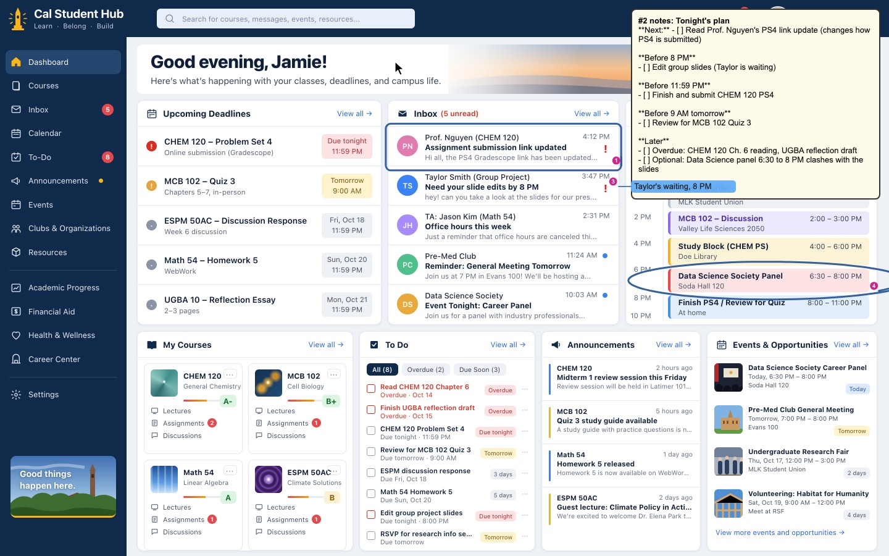

*Blicky's first turn on the Cal Student Hub, graded blind (a headless capture from the chaos-to-clarity harness).*

**The numbers.**
- **302/485 (62%)** of the rubric's criteria on the real screen, two passes of both demos, up from 117/224 (52%) in the
  first exam. The pass bar is 80% over two runs with no slips: **not passed**.
- Chemistry **47/50 (94%)**; reveal **33/34 (97%)**, 1 slip.
- Routing **15/24 → 24/24** (72/72 over 3 seeds) and memory used when only memory can answer **4/12 → 11/12**, same
  seeds before and after the fixes (commit 11829df).
- Chaos to clarity: acceptance tests **6/11 → 8/11**, 0 leaks (commits 1c0229e, 833d3e2).
- Fresh problems, 13 kinds of screen, Blicky blind: **49–51%** per batch (251/493 over 78 graded turns). Leak check:
  **9 of 668** requests flagged (0 in 5 of 6 runs), against 18,943 secret phrases.
- **36/36** turns carry a trust line; **0** key-shaped strings in the committed eval records.
- Blicky's first audio a median **8.55 s** (4.8–17.1 s) after the words were in; Pickle's **2.64 s** (from when he still
  spoke first on every turn).

**Usage and cost.** About **$30 per 1,000 turns** of Claude ($0.030 a turn median, $1.07 for the 36 turns). The whole
blind sweep cost $15.36. Only Claude is totaled: Cartesia, Moss, Jev, Elastic's inference and Factory's credits come on
top.

**What we learned.**
- Only the live run on the real screen showed the dead mic (0/36 steps heard), the 3 steps screenpipe saved no frame
  for, and the slip from a cross-session recap. We keep both: headless for cheap iteration, live for the grade.
- Fresh problems score lower than the demo worksheet (49–51% against 74% on the generated eval's first run, on chemistry,
  physics and math worksheets). That gap is the honest generalization number.
- Demo hints had leaked into the prompts during the build; they came out (commit 2228139) before the second exam, so the
  52% → 62% gain came after the hints were gone.
- 122 of the 183 failed criteria are where Blicky draws, more than the 86 the bar needs. Placement is the next fix.

**The caveat.** Not passed; Claude grades Claude with no human check yet; no student has used it yet; and in exam 2 the
mic failed to start, so all 36 steps' words were handed in (it now retries without voice processing, not yet
re-measured).

**Full page:** [docs/sponsors/microsoft.md](https://github.com/Jshengdev/pickje/blob/master/docs/sponsors/microsoft.md)

---

### Cartesia

**Voice is the interface: there's no chat window to fall back on.** Without Cartesia, pickje is a silent overlay with
captions. Sonic gives the two characters their voices, both cloned on Cartesia from two of our teammates. Ink hears the
student and knows when she's finished. Sonic's word timestamps are the clock that keeps Blicky's voice on the same word
as his pen.

**Their vision, in their words** (Hive's Cartesia track, "Best Use of Cartesia"):

> "Build a useful voice experience with Cartesia. Voice should be core to the product–not just a feature added for the
> demo. Other tools are fine; make clear what Cartesia contributes."
>
> From its Ideas: "Multi-speaker agent — tutor, debate partner, or support sim with distinct voices"

**How pickje answers it.** pickje is the multi-speaker tutor from Cartesia's own list. The student asks out loud, and two
characters answer out loud in two distinct voices: Blicky, the tutor who draws on her page, and Pickle, who cuts in only
to check where her words should go. Every one of Blicky's sentences is held until its pen mark has ink, so her ears and
eyes land on the same spot together. Ink decides when her turn ends, so a pause mid-thought doesn't cut her off, and
when she talks over Blicky, he pauses.

**How it's built.**
- **Sonic 3.6** (`sonic-3.6`) over **one kept WebSocket**, opened on the first turn and kept between turns. The client is
  hand-written on Node 25's built-in WebSocket, no SDK (`app/voice/cartesia.ts`). The key goes only in the `X-API-Key`
  header, and every host but `wss://api.cartesia.ai` is refused.
- **Two characters, one socket** (`app/service/voiceturn.ts`): Pickle's question on its own context; Blicky's say lines
  streamed into one context the moment each is parsed from Claude's output (`continue: true`, `max_buffer_delay_ms: 0`);
  a close-out question on a third context. Pickle's audio always goes first, so the two voices never overlap.
- **The voice waits for its pen** (`BeatGate.swift`): raw `pcm_s16le` at 24 kHz with `add_timestamps: true`. Each
  sentence's audio is held until its mark has ink, split sample-aligned at the pause before its first word, with a 10 s
  safety release. The same timestamps type the speech bubble in step with the voice, and set where "go on" picks up.
- **Tone per line:** Claude may tag a line with one of 9 tones mapped onto Cartesia's emotions, and a speed from 0.6 to
  1.5; later changes ride Cartesia's inline `<emotion>` and `<speed>` tags.
- **Ink 2** (`ink-2`) is the ear (`app/ears/providers/cartesia-ink.ts`): 16 kHz audio in about 100 ms messages; turn
  settings start 0.8, eager end 0.4, end 0.15, end timeout 7,000 ms; keyterms "Blicky" and "Pickle". `turn.start` pauses
  Blicky (barge-in), `turn.update` is the live caption, `turn.end` is her whole turn. If Ink drops, local whisper takes
  over and the panel says so.
- **Privacy:** the mic, and so the stream to Cartesia, opens only after a shake and closes after 60 s idle; only speech
  within 8 s of a shake, or speech that names a character, starts a turn; the panel says "listening · voice goes to
  Cartesia" the whole time.

**The numbers.**
- **183 ms**: Cartesia's own time from a line's text to its first audio, median of 36 live turns. That's 2.1% of
  Blicky's 8.55 s wait: Claude, not the voice, sets the latency.
- **76 of 89** of Blicky's lines waited for their pen mark, with 0 dropped and 0 safety releases in 36 turns.
- Ink ends her turn **304 ms sooner** than the local whisper ear (1,165 against 1,469 ms medians), and kept a 1.6 s
  pause mid-sentence as **one turn 3/3**, where whisper split it 3/3.
- Barge-in: her first sound to Blicky silent in **499 ms** median (481–667, on audio files).
- **36 of 36** live turns played every scheduled frame whole (675 s of Cartesia audio); the voices never overlapped.
- The cloned voices played whole in a real onboarding run: **1,234,560 of 1,234,560** frames (51.4 s at 24 kHz).
- Two voices fill the wait: silence after the question went from **14.9 to 2.4 s** (median of 5 turns, measured while
  Pickle still spoke first on every turn; since 10-25 he speaks only for his check-or-no questions).

**Usage and cost.** Credits weren't metered. By Cartesia's pricing page, TTS is about 1 credit a character and Ink 3
credits a second of open mic (10,800 an hour). The 36-turn live exam spoke 675 s of audio.

**What we learned.**
- Ink's default thresholds ended turns in 310 ms but cut a sentence in two. Ours spend about 0.85 s on patience, since a
  student who loses half her question is worse off than one who waits a beat.
- Cartesia closes a streaming context about 6 s after its last text, so a later line opens a fresh context with its word
  times offset by the audio already sent.
- A speed set on a context's first line changes the audio by about 15%; a speed tag mid-context barely registers.
- Streaming sentence by sentence beats waiting for the whole reply: Blicky's first sentence goes out the moment Claude
  writes it.

**The caveat.** Every timed number used Cartesia library voices, before the clones (the clones are checked to play whole,
not yet timed); and talking over Blicky is unproven live, because Apple's echo cancellation failed to start, so a shake
cuts him off instead.

**Full page:** [docs/sponsors/cartesia.md](https://github.com/Jshengdev/pickje/blob/master/docs/sponsors/cartesia.md)

---

### Moss

**The working memory, inside the talk server, in milliseconds.** Without Moss, pickje waits on a model call to learn
which project a sentence belongs to, and a follow-up can't see what Blicky drew a turn ago. With Moss, both are answered
on the Mac: 6–7 ms to file the sentence when Moss decides, and "now circle the carbonyl carbon on it" lands on atom C3
of the molecule drawn the turn before.

**Their vision, in their words** (Hive's Moss track; the workshop was "Retrieval in 6‑7ms w/ Moss"):

> "1 - Voice AI: Voice agents that listen, respond, and act in real time / 2 - Personal Agent: Agent that remembers you,
> works across your apps, and autonomously handles everyday tasks. / 3 - Social Post: Best engagement"

**How pickje answers it.** pickje is examples 1 and 2 in one product, with Moss under each part. **Listen:** every
sentence Ink hears goes to Moss before any model sees it. **Act, in real time:** Moss files the sentence with no model
call, and the live context keeps the molecule on screen through the next turn and gives Blicky the atom to ring.
**Remembers you:** every project folder, including her own words verbatim, is one warm session (`pickje-projects`).
**Across your apps:** the last 8 hours of screen text from every app screenpipe sees is another (`pickje-screen`,
indexed every 10 s), and each project's working state is a Moss session (`pickje-ctx-<project>`) that Droid, a separate
process, opens by name. **Autonomously:** every sentence has to be filed somewhere. Moss filed 8 of 16 on its own, all 8
right, and when it can't name its evidence it doesn't guess: Claude decides from its top 3.

**How it's built.**
- `@moss-js/moss` **1.21.0**, embedding model **`moss-minilm`**, one `MossClient` in the talk server's process, local
  session indexes only (`app/memory/live.ts`).
- **Route** (`app/memory/route.ts`): three hybrid queries at once (`alpha` 0.6): her words against every project, the
  window against the screens each project was seen on, and her words against intent examples. Moss routes alone when the
  top project scores at least 0.35 and leads by 0.2 on a known screen, or the line is "about the work here" on exactly
  one project's screen. Otherwise Claude decides from Moss's top 3.
- **Recall:** up to 4 older lines from that project (her words, Blicky's notes, the session log; at most 900 characters,
  score at least 0.2) go into Blicky's brief, so she never re-explains.
- **The live shared context** (`app/memory/context.ts`): each turn's marks with their atom aims and each placed molecule
  with its SMILES and atom anchors are upserted, then published with `saveToDisk` and an atomic `latest.json`. Droid's
  worker loads it with `loadFromDisk`.
- **Deliberately never called:** `pushIndex`, `createIndex`, cloud `addDocs`, `loadIndex` and inference retrieval. Each
  would upload screen or voice text, and this repo keeps both on the Mac.

**The numbers.**
- **6–7 ms** median route when Moss decides alone, against **1,332 ms** for a Claude routing call: about 190–222×.
- **16 / 16** turns routed right; Moss filed **8 of 16** with no model call, and Claude decided the rest.
- **7 / 7** runs: "now circle the carbonyl carbon on it" aimed at atom C3 of the molecule drawn a turn before. With Moss
  off, 0 of 1: it drew a second copy and rang a guessed spot.
- **43 of 44** live-context checks passed over 7 runs (1 of 5 with Moss off).
- Moss's time inside Blicky's context read: **1.8–4.4 ms**. Another process loads the latest publish in **0.4–1.5 ms**.
- "Earlier" over the screen history: a **5.6 ms** query over 4,456 chunks.
- Reworded lines in the route check: **9 of 9** decided right, 0 misroutes, median 5.6 ms.

**Usage and cost.** Moss reports 0–2 ms per query; the three route queries take 5–8 ms of wall time. A turn's 6–8
documents go in in 19.0–47.6 ms and publish in 37.4–49.3 ms. On a real hour of screen, 1,503 frames made 9,653 chunks,
and dedupe kept 823 new ones. Session minutes weren't measured (the free plan has 60 a month).

**What we learned.**
- `moss-minilm` saturates on near titles ("PHYS 7A Problem Set 6" scored 1.00 against Problem Set 5's screen), so Moss
  ranks the screens and an exact title match confirms.
- `alpha` 0.6 instead of the default 0.8 keeps exact names, like a course code, counting alongside meaning.
- Local `saveToDisk` and `loadFromDisk` give the cross-agent hand-off without uploading anything.
- When Moss hands Claude its top 3, that route takes a median 2,544 ms, slower than Moss off. That's not explained yet.

**The caveat.** Moss decides about half the routes (8 of 16, then 7 of 16), and the projects-check output wasn't kept,
so those numbers rest on `docs/sponsor-test/metrics.md`.

**Full page:** [docs/sponsors/moss.md](https://github.com/Jshengdev/pickje/blob/master/docs/sponsors/moss.md)

---

### Convex

**The live record of three agents, on the student's own Mac.** Without Convex, pickje couldn't show a student what its
agents are doing while they do it: the card used to read the project folders once when it opened and then never change.
Now every step Pickle takes, every note Blicky writes and every step Droid makes is a Convex transaction, and one live
query brings each one to her card in a median 6 ms.

**Their vision, in their words** (Hive's Convex track):

> "The reactive backend platform that keeps up with you and your agents. Database, functions, workflow, sync, search,
> file storage, and more. All TypeScript, zero glue."

**How pickje answers it.**
- **You:** every step of Mia's turn (route, make, close, a note, a reaction) is one Convex mutation, on her card a median
  6 ms later.
- **Your agents:** Pickle writes `turns:route`, `turns:begin`, `turns:make` and `turns:close`; Blicky writes
  `notes:save`; Droid writes `droid:step` as each step lands. Moss's routing decision rides on `turns:route`, and
  Elastic's answers arrive as `turns:recall`.
- **Database and functions:** 7 typed tables, 12 indexes, 24 TypeScript functions (15 mutations, 9 queries).
  `turns:close` commits the card, the three hot files, the memlog line, the notes, the step row and the trust line in
  one transaction.
- **Workflow:** every slow step is a row that goes from `started` to `done` or `failed` in the same transaction as its
  data, which is how the card says "pickje is writing…".
- **Sync:** one subscription, `card:now`, held through `ConvexClient.onUpdate` and streamed to the Swift app.
- **File storage:** the screen crop a project was made from. **Search:** Moss and Elastic do pickje's search.
- **All TypeScript:** the validators in `schema.ts` are also the mutations' argument types, and Node 25 runs the `.ts`
  files with no build step.

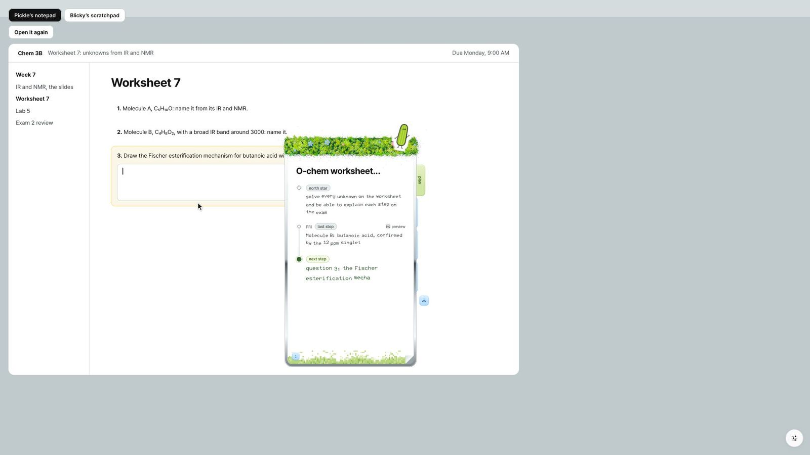

*Pickle's notepad, the card's default look (the design in this repo, `?notepads`, with a staged project). In the app,
the card renders from Convex's `card:now`.*

**How it's built.**
- `convex` **1.48.0** and the self-hosted backend binary (`precompiled-2026-10-24-bb31399`, Apple silicon), downloaded
  from GitHub releases with its SHA-256 pinned, bound to **127.0.0.1**, `--disable-beacon`, no account
  (`app/convex/local.ts`). A separate live profile runs on its own port, so a demo never mixes with real projects.
- The writer (`app/convex/record.ts`): `ConvexHttpClient`, a 2,000 ms write timeout so Convex never holds up a turn, one
  serial queue per process, misses queued and backfilled on reconnect (`app/convex/sync.ts`).
- The one query (`app/convex/convex/card.ts`, `card:now`): projects, the last 20 steps, the current project's 5 newest
  notes, its sessions, its latest Droid run, and the route, trust and recall chips, all read at one commit.
- The talk server subscribes once (`app/convex/live.ts`) and streams each change to the Mac app on `GET /watch`, where
  `LiveCard.swift` redraws in place.

**The numbers.**
- **6 ms** median (5–9) from a Pickle write to the card's Swift stream callback. Before: the card read the folders once
  on open (110–130 ms) and never updated while open.
- **0 of 9** close lines on the stream showed half a turn.
- With Convex stopped, a turn lost **2 ms** and its files were still written; the card caught up **864 ms** after Convex
  came back.
- **57 of 57** Droid steps became rows, a median 6, 7 and 6 ms after each step over three runs.
- **2 of 2** live-profile demo sessions kept with their summaries; **0** rows changed by a backfill, so the folders and
  Convex agree.

**Usage and cost.** A turn on an existing project is 3 mutations; a turn that makes a new project is 5 mutations plus
one storage upload; each note Blicky writes adds one. The whole app holds one standing subscription. It all runs locally,
at $0. The lane is 585 lines of Convex functions in 11 files.

**What we learned.**
- `npx convex dev` binds 0.0.0.0, "where anyone on the venue Wi-Fi could read the projects", sends the self-host beacon
  and asks Convex for the newest backend. So we run the same binary directly, per Convex's own guide, bound to
  127.0.0.1.
- In round 1 a sync sent four separate mutations, so a viewer could see a project before its notes. Each close is now one
  transaction (commit aa4e047).
- The talk service subscribes and the Swift app gains no new package; the extra hop costs 0–1 ms (5 ms to the server,
  6 ms to the Swift callback).

**The caveat.** The project folders are still written first and are what Pickle's prompts read, with Convex as the live
view on top; and the 6 ms runs to the card's stream callback, headless, not the on-screen render.

**Full page:** [docs/sponsors/convex.md](https://github.com/Jshengdev/pickje/blob/master/docs/sponsors/convex.md)

---

### Elastic

**The library across days, on Agent Builder.** Without Elastic, pickje can't reach anything a student did more than 8
hours ago except two summary files. With it, she comes back to a project after a day and Blicky opens with where she
stopped and what she decided.

**Their vision, in their words.** The Devpost gate: "Best use of the Elastic Agent Builder on a Serverless instance". And
the brief Elastic gave builders at its workshop:

> "Build an Agent That Does the Research: Context Engineering with Elasticsearch. Build an AI agent that searches papers
> and project docs, compares approaches, and creates research briefs backed by sources. Get hands-on with Jina
> embeddings, vector and hybrid search, Elastic Agent Builder, and Workflows. Leave with a working research agent you can
> adapt for your Cal Hacks project."

**How pickje answers it.** We took the workshop's research agent and pointed it at the one subject a student with ADHD
keeps losing: her own past work. Everything pickje keeps for a project (her words in a turn and Blicky's answer, each
decision, where a session stopped and what was next, Blicky's notes and her reactions to them, session lines) is embedded
at ingest and brought back to re-prime a session. Captions of screen crops she saved go up only with her yes.
Screenshots, crop pixels and screenpipe's text never go to Elastic: the mapping is `"dynamic": "strict"` over text
fields, and a guard refuses anything else. Bring back's block is a research brief in which every line names its kind and
its date, and the agent starts every answer with when it happened.

**How it's built.**
- **Elastic Cloud Serverless** (Elasticsearch 9.6.0 with Kibana Agent Builder), called with Node's built-in `fetch`, no
  npm package (`app/recall/elastic.ts`).
- **The index `pickje-recall`:** `text` (BM25, `english` analyzer) is copied into `semantic`, a `semantic_text` field
  embedded at ingest by **`.jina-embeddings-v5-text-small`**. pickje computes no embeddings itself.
- **Writes** go through `_bulk` at each close, reaction, Claude Code memlog line and session end, queued so they never
  slow a turn; document ids hash the content, so a resend overwrites instead of doubling.
- **Bring back** (`bringBack`) fires when the gap is 8 h or more (exactly where Moss lets go), when she asks about the
  past, or when a new judging panel's session opens. Three queries run at once under a 3 s budget: the newest
  stopped/decision/reaction documents sorted by time; an **RRF retriever** over BM25 and semantic (`rank_window_size`
  50, `rank_constant` 20, filtered to the project); and the last session's summary.
- **The Agent Builder agent `pickle-archive`**, with six tools created through the Kibana Agent Builder API: a hybrid
  ES|QL tool (`FORK` BM25 and semantic, then `FUSE`), `decisions_since`, `disliked_notes`, `time_on`,
  `where_it_stopped`, and an `index_search` library tool. It's asked through `/api/agent_builder/converse` when the last
  hour of screen has nothing, and answers `NOT_FOUND` when the library doesn't know.
- The live demo profile has its own index and agent (`pickje-recall-live`, `pickle-archive-live`), so panels never mix
  with real projects.

**The numbers.**
- **15/18 and 16/18** past questions with the answer in the top 3 (hybrid RRF, two runs), against **9/18** that Blicky's
  brief alone contains: 1.67x and 1.78x.
- recall@5 with hybrid: **17/18** in both runs.
- The agent `pickle-archive` answered **5/5** in both runs, median **10.1 s**, including **2/2** questions hybrid ranked
  outside its top 3.
- **2/2** reworded questions that plain keyword search missed entirely, found by hybrid in its top 5.
- A hybrid round trip from the Mac to Serverless: **185–224 ms** median (Elasticsearch took 104–105 ms).
- Bring back after a real gap: **328 ms** after 28.9 h (9 hits); **511 ms** after 31.7 h.
- Privacy guard checks **4/4 PASS**; the whole done-check **16 PASS, 0 FAIL**; `build_flavor: "serverless"` confirmed.

**Usage and cost.** The agent reads a median **24,101 input tokens** an answer (26,403 for a live panel question it
answered in 14.1 s). The staged library is 61 documents, embedded at ingest in 2,601 ms.

**What we learned.**
- On 61 documents, plain keyword search ties hybrid at hit@3. Hybrid's value is the library itself and holding up when
  she rewords a question.
- "Where did I leave off?" ranks poorly by score, because older "stopped" documents match just as well. So Bring back
  sorts those by time, and the agent calls `where_it_stopped` instead of trusting a score.
- The agent takes about 10 s, too slow for a voice reply, so it isn't on the main path; Blicky fills the wait with a line.

**The caveat.** In production only staged and test data has gone up (a student's real projects need her yes,
`PICKJE_RECALL_REAL=yes`); the 18 questions are builder-written over 61 synthetic documents; and Bring back hasn't yet been
seen firing inside a recorded live turn.

**Full page:** [docs/sponsors/elastic.md](https://github.com/Jshengdev/pickje/blob/master/docs/sponsors/elastic.md)

---

### Factory

**Droid is Blicky's hands.** In the code's own words (`app/service/droid.ts`): "pickje's hands: Factory's Droid does a
project's actual work, in the project's own folder, on the Droid SDK." Pickle triggers it, Droid does the project's real
work in spec mode inside a fence, and what it makes (references, molecules) becomes what Blicky shows on the next turn.

**Their vision, in their words** (Hive's Factory track, "Best Use of the Factory Droid SDK"):

> "Eligibility: The project must use the Droid SDK (TypeScript or Python) in a meaningful way. Droid should do real work
> in the running product, not just help you write code. The repo README should explain where and how Droid is used."
>
> What scores well: "Droid runs on a trigger you designed, like an event, a schedule, a user action, or another agent."
> · "Thoughtful control over what Droid can touch, with safety built in." · "Making Droid's work visible: plans, steps,
> diffs, and results."

**How pickje answers it.**
- **Real work in the running product.** She says "can you make me a practice problem like this?", and Droid draws 2 or 3
  new molecules from SMILES it writes, then saves a note with the problems and their answers. Blicky teaches from both on
  the next turn.
- **Triggers we designed, none of them a chat box:** her spoken hand-over (a user action), Pickle closing a turn with a
  next step Droid can make (another agent), and her words asking for practice.
- **Control, with safety built in:** autonomy Off, 29 of Droid's built-in tools switched off (its shell, the web, its own
  Create and Edit), and only four tools pickje serves to write with, fenced to the project folder.
- **Visible:** the plan ("got it: …"), every step, and a receipt with time, turns and credits, all on her card.

**How it's built.**
- `@factory/droid-sdk` **0.10.0** on the `droid` CLI 0.249.0; Droid's model `claude-haiku-5-5` at `low` effort
  (`app/service/droid.ts`).
- `createSession({cwd: subjects/<project>/, autonomyLevel: Off, interactionMode: Spec, disabledToolIds, mcpServers,
  permissionHandler, …})`, one session per project; `resumeSession` picks it up next time and goes back into spec mode.
- `createSdkMcpServer({name: 'pickle'})` with four tools, Droid's only way to write: `write_file`, `save_note` (through
  Pickle's own notes, so it reaches Convex and the card), `save_reference` (an SVG that joins Blicky's place list;
  `<script>`, `on*=` and `<foreignObject>` refused) and `draw_structure` (a molecule from Droid's SMILES, drawn with
  OpenChemLib 9.25.1 with an anchor on every atom).
- `permissionHandler`: the plan waits at `exit_spec_mode` for a yes; every other call must be one of Pickle's tools, with
  its path through `insideProject` (symlinks resolved; nothing outside the folder; never Pickle's own memory files), and
  is allowed once, never "always". `session.listTools()` refuses to run on any tool we haven't vetted.
- Every step goes to `steps.jsonl`, `GET /droid/watch` and a Convex `droid:step` row. Before it plans, Droid's worker
  loads what Pickle and Blicky just did from the project's Moss session.
- The next-step and practice triggers are off by default (`PICKJE_DROID_NEXT=1` turns them on), because every plan
  spends credits.

**The numbers.**
- **22 / 22** fence checks passed, including a real Droid write through a symlink to `/tmp` that was refused and left no
  file.
- **1 / 1** offer held in the live exam on the real screen: it went unanswered, the SDK replied "Plan not approved -
  remaining in Spec Mode", and the run ended "rejected: nothing written, 41.2 s, 1261 credits".
- **3 / 3** practice sets done in **33.7, 52.9 and 33.3 s**; **81 / 81** check criteria.
- **57 / 57** Droid steps reached the card through Convex, a median 6–7 ms after each.
- Hand-over check **37 / 37**; the chemistry judge's Droid step **8 / 8** criteria.
- **9** steps visible per hand-over, against **0** on the Claude Code path. Her yes to Droid working: **202–203 ms**.

**Usage and cost.** Factory credits per practice set: **2,346–2,942** (median 2,431); a hand-over 852–1,290; an offer she
doesn't answer still costs its plan (1,261). The plan comes back in 16.8–23.5 s for a practice set and a median 6.2 s for
a hand-over.

**What we learned.**
- At autonomy "low", Droid's own Create wrote a file outside its folder with no permission request at all. So autonomy
  Off plus four served tools is the fence, not a permission handler alone.
- Droid isn't faster than a Claude Code background session (a median 8.1 s against 7.1 s on a stand-in task). What it
  buys is visible steps and the fence.
- Run 1's note cited two cut file names, so names are capped at 40 characters and a note naming a missing file is
  refused.

**The caveat.** The practice runs are check runs on scratch projects, not yet seen whole through the app on the real
screen; reads aren't fenced (a read outside the folder is logged, not stopped); and there are no diffs yet.

**Full page:** [docs/sponsors/factory.md](https://github.com/Jshengdev/pickje/blob/master/docs/sponsors/factory.md)

---

### Mana

**The project's living memory, open to anyone.** The whole build (415 linked pages, 22 spec cards, 248 test cases and a
staged idea log) is two Mana apps a judge opens signed out, and one JSON tree in our Mana space that Mana's own agent can
read as the project's memory: [mana.space/home/…/pickje](https://www.mana.space/home/4AcsNaiqj9gLBK0bQ7kQOAt7BTo2/pickje).

**Their vision, in their words** (Hive's Mana track):

> "Use Mana meaningfully while building your project. In your submission, say where Mana helped and link one or two
> Mana pages or chats you used ... Make each link public so judges can open it ... In your demo, show one moment where
> Mana changed what you built or how fast you built it. ... Bonus (up to +10): Your project lives inside Mana as an app
> or agent a judge can open and use. A small thing that works beats an ambitious idea that only exists in slides."

**How pickje answers it.**
- **The idea log** is the verb Curate: a project's ideation as a time log, with each decision and its why, Blicky's
  notes with the student's reaction, and where each session stopped. Today it's staged: 36 entries over 3 made-up
  projects.
- **The lab notebook** is the whole build, 10-20 to 10-25: 415 first-person pages joined by 1,271 links, 22 spec cards
  with all 177 click questions and the pick for each, 12 eval sets with 248 cases, the sponsor tradeoffs, 18 test runs, a
  style book and a map. Each outcome is marked kept, revised, dropped, declined or open, and dropped pages stay, crossed
  out.
- **Where Mana helped:** the memory and its sharing. It didn't write the code.
- **The moments Mana changed what we built:** on 10-24 we found Mana's external API and its app model (an app is a
  `user_div` node holding React code, with its data as child nodes), which replaced a "chat import" that doesn't exist
  and gave both apps their shape. On 10-25, building for Mana turned the build's scattered evals into sets with one case
  per line, each naming its last result and its source.

**How it's built.**
- **The idea log** (pickje repo: `app/mana/publish.ts`, `app/mana/viewer.js`): staged entries, a guard, a preview with a
  sha256 digest that was approved before anything went up, one multi-path `update`, and a read-back.
- **The lab notebook** (this repo: [mana/](mana/), with [build.mjs](mana/build.mjs), [app.js](mana/app.js),
  `data/`, [evalsets/](mana/evalsets/) and `img/`): pages from 7 lanes, scrubbed of key shapes and home paths, a style
  book read from the real design tokens, written in batches of 60 pages and read back.
- **4 of Mana's 138 API routes** (`GET me`, `POST read`, `update`, `delete`); `write`, `push` and `context` are refused
  in code; one locked path per app, so a bug can't touch the rest of the space.
- Both apps are plain `React.createElement` with no packages, reading their own node live with Mana's `FS.onValue`. The
  notebook has 11 tabs: Notebook, Map, Specs, Eval sets, Sponsors, Test runs, How to, Style book, Open threads, Pictures,
  About.

**The numbers.**
- **415/415** notebook pages written to Mana and read back; **2** apps open at the public link, signed out.
- **1,271** links between pages, **0** dangling.
- **12** eval sets, **248** cases, **248/248** naming their last result and its source.
- **22** spec cards, **177** click questions, **177/177** with the pick.
- **371/371** numbers on the pages name their source; **415/415** pages list their sources.
- **36/36** idea-log entries read back; **4 of 138** routes used (2.9%).

**Usage and cost.** The notebook is 11 collections, about 1.06 MB in one Mana node. Since that publish, the notebook's
source in this repo has grown to 417 pages and 13 eval sets; the 13th is the Focus Thread set, 34 cases written before
the feature is built, not run.

**What we learned.**
- Mana has no public docs, SDK, CLI or MCP server, so we read its API spec and web bundle and installed a working app,
  code and data together, from a CLI.
- The key reaches the whole space with no scope option, so the code limits it: four routes, one path per app, an
  ownership mark, and no overwriting a node it didn't make.

**The caveat.** Mana didn't shape the code or speed it up; no product path writes to Mana yet; and the latest blind judge
scored the track "(c) bolted on", before the link went public and before the notebook existed.

**Full page:** [docs/sponsors/mana.md](https://github.com/Jshengdev/pickje/blob/master/docs/sponsors/mana.md)

---

## The design system

This repo is also the final presentation's home, and it runs on the pickje brand system. Everything you need to make
beautiful, on-brand slides is here: the design tokens; the materials (metal, felt, moss); the cast, Pickle and Blicky;
the UI kit and the charts; the 58-page brand book that shows how it all fits; and a materials lab to experiment in.

**Polishing the deck? Start with [`docs/FOR-THE-DECK.md`](docs/FOR-THE-DECK.md)**: how to run it, the story and the facts
with their sources, the demo beats, the brand rules, and the calls that are Johnny's.

### Run it

```bash
npm install
npm run dev          # http://127.0.0.1:5320
```

| URL | What |
|---|---|
| `/` | **The brand book.** 58 pages, every one live code. ← → to page, G for the grid. |
| `/?deck=pitch` | **The final presentation.** 22 slides; the script is [deck/pitch/SCRIPT.md](deck/pitch/SCRIPT.md). |
| `/?lab` | **The materials lab.** Material × form × colour × light; stack 2 layers; keep presets. |
| `/?notepads` | **The two final notepads, live.** Pickle's notepad and Blicky's scratchpad (`?notepads=blicky`); replay, tune, screenshot. |

| Command | What |
|---|---|
| `npm run pdf` | Writes every slide to `deck/exports/pickje-deck.pdf` at 1920 × 1080 (needs `npm run dev` running). `DECK=pitch npm run pdf` exports the presentation. |
| `npm run tokens` | Regenerates the tokens after you edit `design/tools/tokens.mjs`. |
| `npm run typecheck` | Checks the types. |

The dials (DialKit, bottom right) tune materials and layout live. Their starting values are in `deck/src/dials.json`, and
they hide in print.

### Where things are

```
design/
  BRAND.md              the brand guideline, short form: read this first
  STYLE.md              the 11 rules for code
  tools/tokens.mjs      the one source of every value (colour, type, space, radius, motion, materials)
  src/tokens/           generated tokens (CSS variables, TS), fonts (Geist Pixel, Fairfax HD, OFL)
  src/material/         <Surface>: metal, felt, flock, moss on one shared WebGL renderer; CC0 textures
  src/cast/             Pickle and Blicky as drawn; <Pickle pose look>, <Blicky pose look>, <Say>; PickleFace (alive)
  src/ui/kit/           Card, Tray, Band, Button, Toggle, Tag, Key, Meter, Stat, Printed, Logo, Wordmark,
                        Banner, Scribble, Bars, Flow
  src/ui/product/       the product's own surfaces: NotesPad (the two final notepads), Notepad (tabs), Routing
  src/material/Glass.tsx  glass plastic, for small parts only
  src/cast/Live.tsx     Pickle and Blicky's 11 everyday states (asleep, idle, listening, working, talking, sketching…)
  src/engine/           GSAP with the brand's named eases
deck/
  src/brand/            the brand book (frame.tsx = the page frame; slides-a…d; index.tsx = the order)
  src/pitch/            THE FINAL PRESENTATION: start here
  src/lab/              the materials lab
  src/notepads/         the two final notepads, live (?notepads)
  pitch/SCRIPT.md       the pitch, slide by slide, with his run-throughs verbatim
  pitch/OUTLINE-draft1.md   the draft story (11 slides); every line is his words, a fact with proof, or a draft
mana/
  build.mjs · app.js    the Mana lab notebook: the build script and the app (see Mana, above)
  data/ · evalsets/     the notebook's pages by lane, and its eval sets, one case per line (.jsonl)
  img/                  the notebook's pictures, including the slide images on this page
docs/
  FOR-THE-DECK.md       start here if you're polishing the deck
  PRODUCT.md            what pickje is, how it was tested, the numbers (the product's README)
  SPONSORS.md · EVALS.md · EVENT.md · VERBS.md   the tracks, the eval record, the event rules, his vocabulary
  frontend-plan/        the plan for putting the notepads in the Mac app; renders and art of both pads
  refs/2026-10-24/      his Cofounder and notepad references, mapped to his words
  spec/design-02-blicky-states.md   the cast's states, the notepads, metal and glass, in his words with build logs
  SPEC.md               the product spec, with his words verbatim
  STATUS.md             what works, with proof; slides cite numbers from here
  spec/design-01-branding-and-motion.md   every design decision in his words, in order, with build logs
  spec/design-01-refs/  his 12 picks (s01–s12): the source of the brand
```

### Making a slide

Slides build one idea per → press, and each can have its own dials: see [deck/src/pitch/README.md](deck/src/pitch/README.md).

```tsx
import { Surface } from '@design/material/Surface'
import { Card, Tray, Meter, Bars } from '@design/ui/kit'
import { Pickle, Say } from '@design/cast/Cast'
import { Page } from '../brand/frame'

export function TheMoment() {
  return (
    <Page title="It already knows what you’re looking at">
      <Tray width={1728} height={420} scale={1.6}>
        <Card width={520} height={320} scale={1.6} lifted>…</Card>
      </Tray>
    </Page>
  )
}
```

Then add it to `deck/src/pitch/index.tsx`: `{ title: 'The moment', chapter: 'Demo', render: TheMoment }`.

The 5 templates (Title, Chapter, Content, Numbers, Moment) and the banner generator are on the brand book's "Building a
deck" chapter. Copy one and change the words.

### The short version of the brand

- **Colour:** silver and forest felt lead (60 / 30); the cast and signals are the last 10. Roles, never hex.
- **Type, 4 voices:**
  - Pretendard for people
  - Fairfax HD as the second voice (sentences only)
  - Geist Pixel Circle for what the cast says and prints
  - Geist Pixel for the machine and every count
- **Materials:**
  - Metal carries content and takes any form.
  - Felt holds things.
  - Moss means alive and wraps any shape.
  - One light, from the upper left.
- **Every slide:** a title that's a short sentence with a verb, then the real thing. Captions only when they add something.
- **Every number names its source**, for example "docs/STATUS.md, C4".
- **Never** any of the 21 signs of a careless page (BRAND.md §13): stripes, borders round blocks, badges, monospace labels, placeholders, glass, glow, purple gradients, light-grey text, entrance animations, proof nobody can check, …

**Open call:** the logo. There are 6 directions on page 9 of the book; the pick is still to be made.

## Credits

See [CREDITS.md](CREDITS.md). Fonts are OFL and textures are CC0; all code was written during the hacking period.
